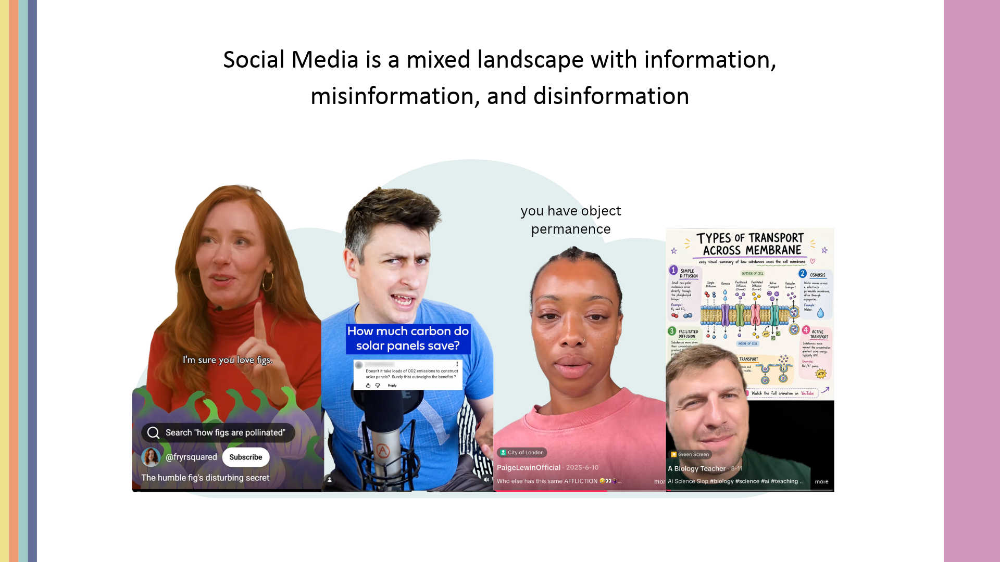
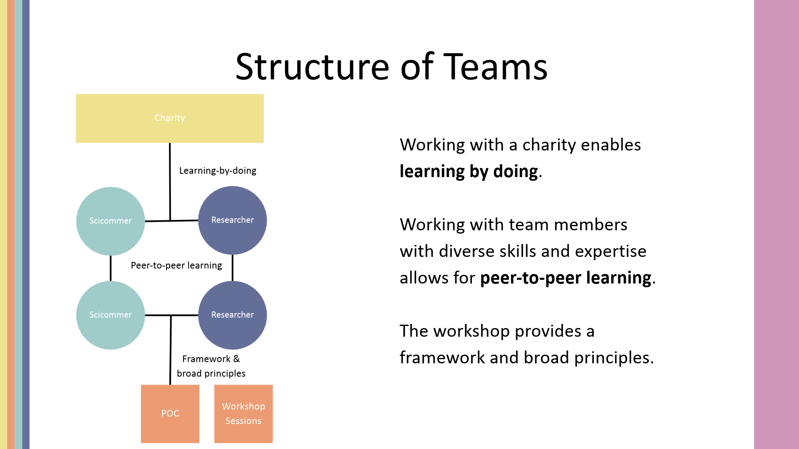

Authored by: Shweata Hegde

If you are  reading this, you probably don't need me emphasising the importance of using social media for science communication. But allow me to elaborate on just how important social media is as a media platform for scientists and science communicators.

According to a [2025 report](https://reutersinstitute.politics.ox.ac.uk/digital-news-report/2025/dnr-executive-summary) by the Reuters Institute in Oxford and the University of Oxford, 65% of people worldwide now consume video on social media. Similarly, a recent [Nature Editorial](https://www.nature.com/articles/d41586-026-01723-1) read: “...social-first and visual content is likely to become the dominant form of news. If science communicators want to remain relevant, they need to embrace this change.” The challenge with social media is, it is a mixed landscape: where information, misinformation, disinformation exist.

Which is why we need more trained and skilled scientists and science communicators online. The latest [Science for Society report](https://royalsociety.org/news-resources/projects/science-for-society/) by The Royal Society recommends "Universities, funders and research organisations should value communications skills as a vital component of research culture to help counter mis- and disinformation. They should embed training and support for scientists to capitalise on opportunities to connect with audiences via social media (pg. 19)".

Therefore, as two student societies with a dedicated focus on science communication, we set up this workshop series, where we introduce participants to the 101s of science communication on social media, and promote learning-by-doing by partnering with charities for whom the participants produce social media videos.

